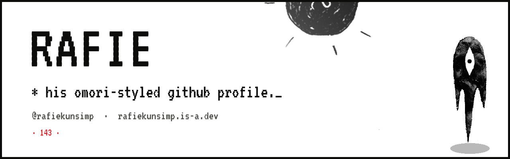
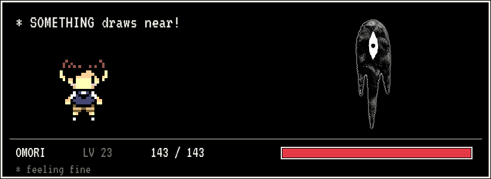

<p align="center">
  <b>Rafie</b> · <sub>@Rafiekunsimp</sub> · <sub>LV 23</sub>
</p>

<p align="center">
  <sub>* web dev, data analytics, and a whole lot of omori._</sub>
</p>

<br />

---

### ▸ BATTLE

<p align="center">
  
</p>

<p align="center"><sub>* your contributions, one turn at a time._</sub></p>

---

### ▸ STATUS

```yaml
player:     Rafie
world:      Earth
language:   English
lv:         23

projects:
  - QwFNfer
  - XryWeb

gear:
  os:   CachyOS, Fedora, Windows
  ide:  Zed, Visual Studio Code

interests:
  - Omori
  - Minecraft
  - Web Development
  - Data Analytics
  - Red Bull enthusiast
```

---

### ▸ SKILLS

<p align="center"><sub>* RAFIE learned these techniques!_</sub></p>

<p align="left">
  
  
  
  
  
  
  
  
  
  
  
</p>

---

### ▸ GEAR

<p align="center"><sub>* the items rafie carries._</sub></p>

<p align="left">
  
  
  
  
  
  
  
  
</p>

---

### ▸ VIEWS

<p align="center">
  <a href="https://komarev.com/ghpvc/?username=Rafiekunsimp">
    
  </a>
</p>

<p align="center">
  
  
</p>

---

### ▸ CONNECT

<p align="center">
  <a href="mailto:reef@rafiekunsimp.is-a.dev"><b>reef@rafiekunsimp.is-a.dev</b></a>
  <br />
  <sub>
    site · <a href="https://rafiekunsimp.is-a.dev/">rafiekunsimp.is-a.dev</a> ·
    x · <a href="https://x.com/Justchef_reef">@Justchef_reef</a> ·
    discord · <a href="https://discord.com/users/744808879036170272">744808879036170272</a> ·
    instagram · <a href="https://instagram.com/rafie_kun_simp">@rafie_kun_simp</a>
  </sub>
</p>

<p align="center">
  <a href="mailto:reef@rafiekunsimp.is-a.dev"></a>
  <a href="https://rafiekunsimp.is-a.dev/"></a>
  <a href="https://x.com/Justchef_reef"></a>
  <a href="https://discord.com/users/744808879036170272"></a>
  <a href="https://instagram.com/rafie_kun_simp"></a>
</p>

---

<p align="center">
  
  <br />
  <sub>* made with something._</sub>
</p>
